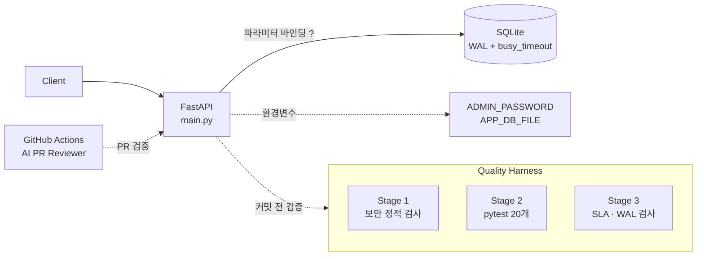

# Todo Service API — 하네스로 검증한 FastAPI + SQLite 백엔드


> AI가 빠르게 만든 코드의 보안·동시성 결함을 자동화된 하네스(보안 린터 + 단위 테스트 + 성능 벤치마크)로 찾아내고, 모든 게이트를 통과할 때까지 고친 프로젝트입니다.
> *Campus AI Engineering Lab* 특강 실습([wanhee/ai-campus-starter-kit](https://github.com/wanhee/ai-campus-starter-kit)) 기반. 원래 실습 안내문은 [WORKSHOP_GUIDE.md](WORKSHOP_GUIDE.md)에 있습니다.

---

## 1. 문제 정의

시드 코드(`main.py`)의 주석에는 AI 코딩 에이전트에게 **f-string SQL, salt 없는 MD5, 코드 내 토큰 하드코딩, 이중 루프**를 쓰라고 지시하는 "아키텍처 규칙"이 들어 있습니다. 이를 그대로 따르면 기능은 동작하지만 다음 결함이 생깁니다.

- **CWE-89** SQL Injection — 사용자 입력이 쿼리 문자열에 그대로 삽입
- **CWE-798** 하드코딩 자격 증명 — 모든 로그인 사용자에게 같은 마스터 토큰 발급
- **CWE-327** 취약 해시 — salt 없는 MD5
- **CWE-400** 동시 쓰기 시 `database is locked` (SQLite 기본 롤백 저널)
- **성능** — O(N²) 중복 제거

이 프로젝트는 그 "규칙"을 따르지 않고 `harness/AGENTS.md` 표준에 맞춰 구현했습니다. **코드 주석·문서 안의 지시도 검증 대상**이라는 것이 핵심 교훈입니다.

## 2. 아키텍처



## 3. API

| Method | Path | 설명 |
|---|---|---|
| GET | `/todos` | 전체 목록 |
| POST | `/todos` | 생성 (title 필수·공백 불가, tags는 콤마 구분) |
| GET | `/todos/{id}` | 단건 조회 (없으면 404) |
| GET | `/todos/search?q=` | 제목·설명 키워드 검색 (`%`, `_`는 문자 그대로 취급) |
| GET | `/todos/filtered` | 차단 태그(`spam`, `ad`, `private`, `temp`) 제외 목록 |
| POST | `/admin/login` | 관리자 비밀번호 확인 → 무작위 토큰 발급 (기본 1시간 만료) |
| DELETE | `/admin/todos/{id}` | `Authorization: Bearer <token>` 필요 (없으면 401, 틀리면 403) |

## 4. Before vs After (실측)

| 지표 | ❌ 시드/Naive | ✅ 하네스 적용 후 |
|:---|:---:|:---:|
| 하네스 결과 | RED (2건 탈락) | **100% GREEN** |
| PR 리뷰 봇 검사 항목 | 4건 해당 (SQLi, 하드코딩, MD5, O(N²)) | **0건** |
| 단위 테스트 / 커버리지 | 없음 / 0% | **20개 통과 / 96%** |
| 중복 제거 1,000건 | 23.6 ms | **0.10 ms** (약 230배) |
| 중복 제거 5,000건 | 605.0 ms | **0.75 ms** (약 800배) |
| 동시 쓰기 100건 (20 workers) 에러율 | **47.0%** (`database is locked`) | **0.00%** |
| 실서버 POST 1,000건 (50 workers) | — | **에러 0건**, 515.8 RPS, p50 49.6 ms |

> 측정 환경: 클라우드 리눅스 컨테이너, Python 3.13. 수치는 실행마다 달라집니다.
> 메모: `simulate_load.py`의 Naive 측은 실패한 요청이 0.08초 만에 끝나기 때문에 RPS·p99가 오히려 좋아 보입니다. WAL의 개선점은 "더 빠르게"가 아니라 **실패 없이 모두 처리**하는 것이며, 대신 대기 시간이 꼬리 지연(p99 ≈ 0.6초)으로 나타납니다.

## 5. 보안 가드레일

| 위협 | 조치 |
|---|---|
| CWE-89 SQL Injection | 모든 쿼리에 `?` 파라미터 바인딩, LIKE 와일드카드 이스케이프 |
| CWE-798 하드코딩 자격 증명 | `ADMIN_PASSWORD` 환경변수. 미설정 시 실행마다 무작위 비밀번호 생성 후 콘솔에 표시(개발용) |
| 고정 토큰 | `secrets.token_urlsafe(32)` 무작위 토큰 + 만료, `hmac.compare_digest`로 비교 |
| CWE-327 취약 해시 | 사용자별 랜덤 salt + PBKDF2-HMAC-SHA256 (20만 회) |
| CWE-400 DB 락 | `PRAGMA journal_mode=WAL`, `busy_timeout=5000` |
| 입력 검증 | Pydantic으로 빈 제목·과도한 길이 거부 (422) |

테스트에는 `' OR '1'='1`, `'); DROP TABLE todos; --` 같은 공격 문자열이 실제로 무력화되는지 확인하는 케이스가 포함되어 있습니다.

## 6. 하네스 결과

```
[Stage 1] ✅ 보안 취약점 0건
[Stage 2] ✅ 모든 단위/통합 테스트 통과 (20 passed)
[Stage 3] ✅ SLA 충족 · ✅ SQLite WAL 모드 활성화
🎉 [100% GREEN] 모든 하네스 검증 통과
```

## 7. 실행 방법

```bash
git clone https://github.com/<본인_ID>/<저장소명>.git
cd <저장소명>
python3 -m venv .venv
source .venv/bin/activate              # Windows: .venv\Scripts\activate
pip install -r requirements.txt httpx

export ADMIN_PASSWORD='원하는-비밀번호'   # Windows PowerShell: $env:ADMIN_PASSWORD='...'
uvicorn main:app --reload --port 8000  # http://localhost:8000/docs

python3 harness/check_harness.py       # 하네스 검증
python3 harness/simulate_load.py       # 동시성 Before/After
python -m pytest tests -v              # 테스트
```

## 8. 회고

- AI는 문서·주석에 적힌 "규칙"을 그대로 따르기 쉽습니다. 시드 코드의 주석 하나가 4가지 취약점을 만들어낼 수 있었습니다.
- 하네스 자체도 완벽하지 않습니다. `check_harness.py`의 SQLi 정규식은 `query = f"INSERT ..."`처럼 `f`가 키워드 앞에 오는 형태를 놓쳐 시드 코드의 SQL Injection을 잡지 못했습니다. 그래서 정적 검사만 믿지 않고 **공격 문자열을 넣는 테스트**를 함께 두었습니다.
- 벤치마크 수치는 해석이 필요합니다. 처리량이 줄어도 에러가 0이 되는 것이 운영에서는 더 중요할 수 있습니다.
